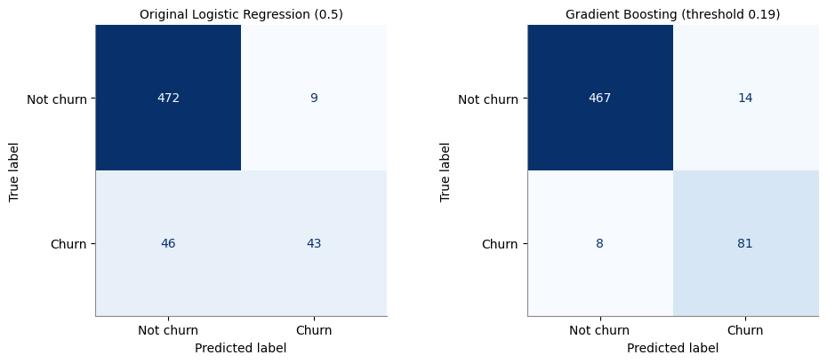
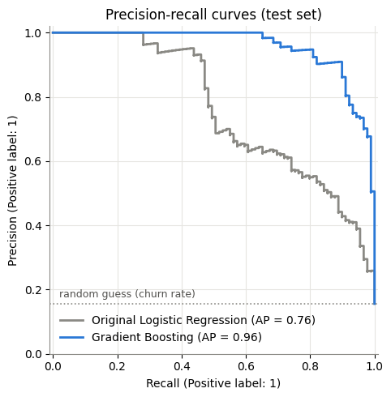
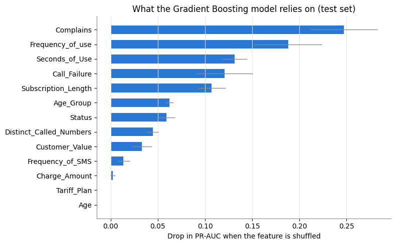

# Customer Churn Prediction: When 90% Accuracy Isn't Good Enough

My first churn model had **90% accuracy**, but it **missed 46 of the 89 customers who actually left**. This project finds out why and fixes it. The improved model misses **only 8**.

Churn prediction applies to any subscription business: telecom, banking, insurance, streaming, SaaS. The goal is to flag customers who are likely to leave **early enough to act**.

## Dataset
[Iranian Churn Dataset](https://doi.org/10.24432/C5JW3Z) (UCI Machine Learning Repository)
- 3,150 customers of an Iranian telecom company, 13 features (call failures, complaints, usage, SMS, subscription length, tariff plan, age, customer value)
- Features cover **months 1–9**; churn is measured at **month 12**, so the model predicts churn 3 months ahead
- 300 duplicate rows removed → 2,850 customers, **15.6% churn** (imbalanced)

The dataset is not included in this repo. Download it from the link above.

## Results (test set, 570 customers, 89 churners)
| Model | Recall | Precision | F1 | PR-AUC | Churners missed |
|---|---|---|---|---|---|
| Always "no churn" (baseline) | 0.00 | – | 0.00 | 0.16 | 89 |
| Logistic Regression (original) | 0.48 | 0.83 | 0.61 | 0.76 | 46 |
| **Gradient Boosting + tuned threshold** | **0.91** | **0.85** | **0.88** | **0.96** | **8** |

## What I did
1. **Exposed the accuracy trap.** A model that always says "no churn" already gets 84% accuracy, so 90% was only slightly better than doing nothing.
2. **Found why the coefficients looked strange.** Three feature pairs were near-copies (r > 0.9), e.g. call seconds vs call frequency. This made Logistic Regression give one a positive and the other a negative effect. Removing the copies made the coefficients sensible with no loss in performance.
3. **Compared 4 models with 5-fold cross-validation** on the training set, using **PR-AUC** (better than accuracy or ROC-AUC when the positive class is rare).
4. **Tuned the decision threshold** (0.5 → 0.19) using out-of-fold predictions on the training set, to catch more churners while keeping precision high.
5. **Used the test set only once**, for the final evaluation.
6. **Explained the model** with permutation importance and checked the top signals directly in the data.

## Key findings
- **Class weights alone didn't fix it.** They raised Logistic Regression's recall to 0.86, but precision fell to 0.50 and PR-AUC didn't change. Weights and thresholds only move along the same trade-off; a **better model** moves the whole curve.
- **Tree models captured non-linear patterns** that Logistic Regression couldn't (cross-validation PR-AUC 0.75 → 0.95).
- **Strongest churn signals:** complaints (81% churn vs 10% without a complaint), low usage (32% churn in the lowest-usage quarter vs about 1% in the highest), and call failures.

## Limitations
- Data from one telecom operator in one country; other markets may differ.
- Small test set (89 churners): 1 churner ≈ 1.1 points of recall.
- Gradient Boosting results change slightly between scikit-learn versions (threshold 0.19–0.24, 8–9 missed churners). The numbers above are from a Google Colab run.
- The threshold rule (max F1) is neutral. A real company should set it from the actual cost of a missed churner vs a retention offer.
- Importance shows association, not cause.

## How to run
1. Open `churn_prediction_improved.ipynb` in Google Colab (or Jupyter).
2. Run the first cell and upload `Customer Churn.csv`.
3. Run all cells. Charts are saved in `figures/`.

Requirements: Python 3, pandas, NumPy, scikit-learn, matplotlib.

## Background
This started as my individual project for CSC61304 (Machine Learning and Intelligent Systems) at Taylor's University. I extended it afterwards to fix the weaknesses I found in my own results.

**Author:** Mohammad Aqel · [GitHub](https://github.com/mohammad-aqel-ai)
